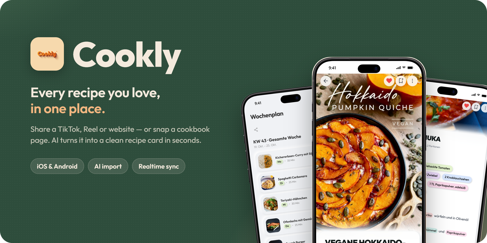
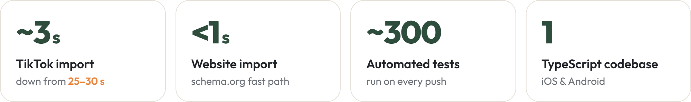
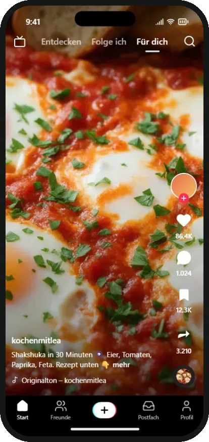
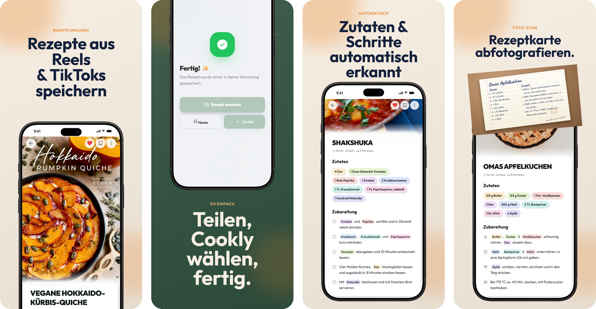
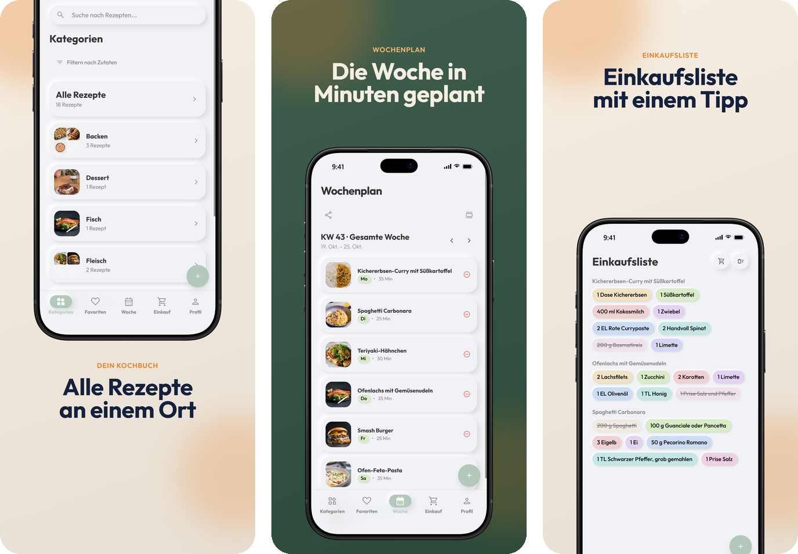
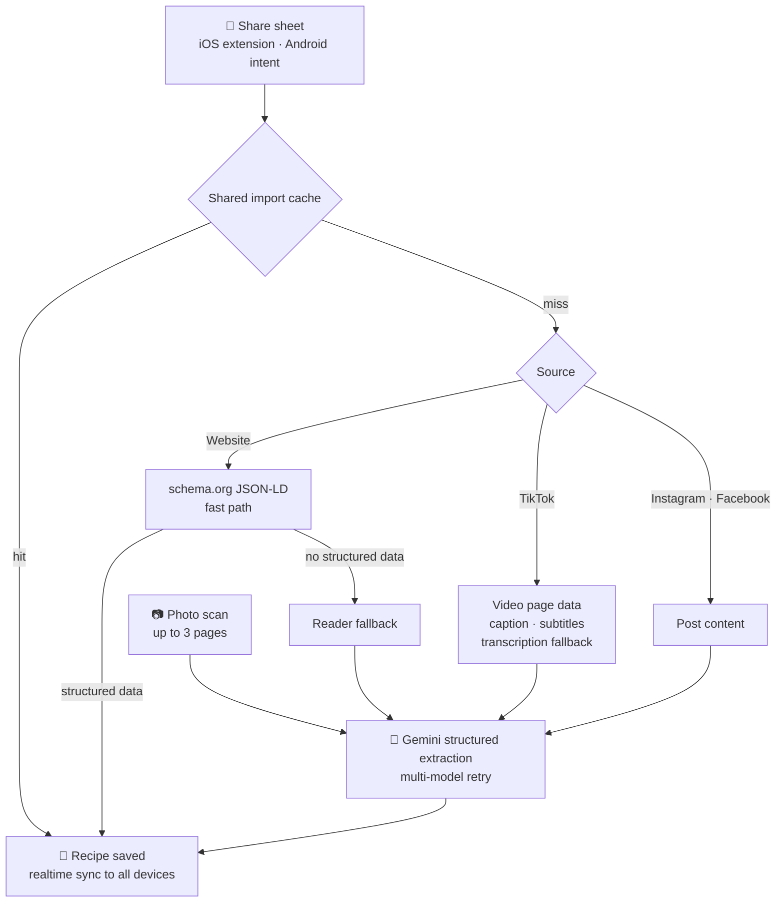
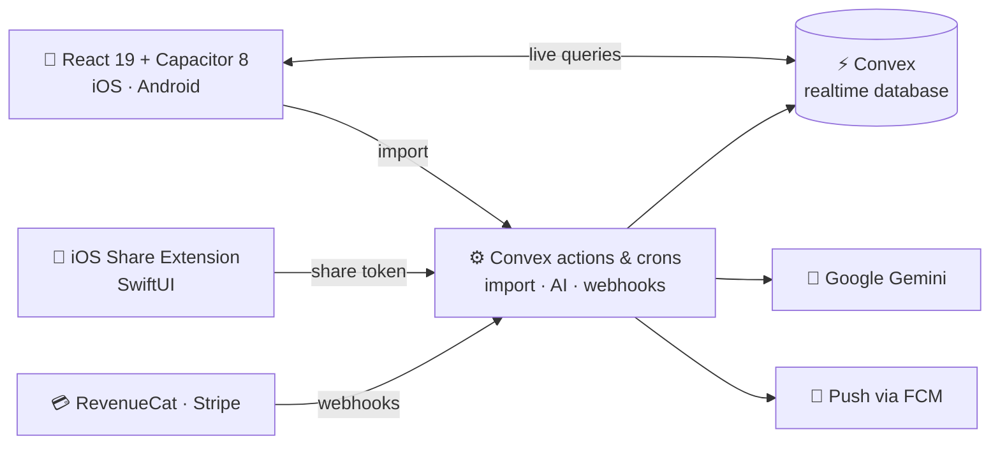

<div align="center">



<br>

<a href="https://apps.apple.com/de/app/id6809963985"></a>
&nbsp;


<a href="https://github.com/NicoDev01/cookly-app/actions/workflows/quality.yml"></a>


### Save recipes from TikTok, Instagram, any website or a cookbook photo.<br>AI turns them into clean recipe cards. Then plan, shop and cook.

[Share overlay](#-the-signature-feature-share--saved) · [Features](#-features) · [Screenshots](#-screenshots) · [Import pipeline](#-the-import-pipeline) · [Architecture](#%EF%B8%8F-architecture) · [Engineering](#-engineering-highlights) · [Run it](#-run-it-locally)

<br>

<picture>
  <source media="(prefers-color-scheme: dark)" srcset=".github/readme/stats-dark.png">
  
</picture>

</div>

## 🍳 Why Cookly?

Recipes live everywhere: a Reel saved on Instagram, a TikTok bookmarked weeks ago, a browser tab, a page in grandma's cookbook. When it's time to cook, none of them can be found.

Cookly fixes that with one gesture: **tap _Share_ → pick Cookly → done.** Ingredients, steps, servings and a cover photo are extracted automatically and land in one tidy cookbook that syncs across devices in real time.

Cookly is an independent project, designed, built and shipped end to end by one developer: product, UI design, backend, native code, CI and App Store release. It's **live on the App Store**, and the Android version is in testing.

## ⚡ The signature feature: share → saved

<table>
<tr>
<td width="42%" align="center" valign="middle">

</td>
<td width="58%" valign="middle">

Most recipe apps make you leave the video, open the app, wait, and come back. Cookly doesn't.

Sharing from TikTok, Instagram or Safari opens a **native SwiftUI card on top of the source app**. Progress, cover image, ingredient pills and steps build up live, and the recipe is saved automatically. Swipe it away and you're right back in your feed.

**Under the hood**
- iOS Share Extension written in **SwiftUI**, separate from the web-based app
- Authenticates with a **scoped share token** stored in a shared Keychain access group, never the user's session
- Starts a server-side **import operation** and polls its phases (`scrape → extract → save`)
- Operation IDs make imports **idempotent**: sharing the same post twice shows *"Already in your cookbook"*
- Handles every edge case in place: no recipe found, free limit reached, offline, slow import (*"close anytime, Cookly keeps saving"*)
- Spring animations and drag-to-dismiss; falls back to opening the app when needed

<sub>The animation is recorded from the interactive prototype the SwiftUI overlay was designed from.</sub>

</td>
</tr>
</table>

## ✨ Features

<table>
<tr>
<td width="50%" valign="top">

#### 📥 Import from anywhere
- **Share sheet import** from TikTok, Instagram, Facebook and the browser
- **Website import** in under a second when the page has schema.org recipe data
- **Photo scan** of printed or handwritten recipes, up to 3 pages per recipe
- **Manual entry** for family recipes

</td>
<td width="50%" valign="top">

#### 🗂️ Organize
- **Categories**, **favorites** and one search across recipes, categories and ingredients
- **Source pill** on every recipe links back to the original post or site
- **Offline-first**: recent data is cached, edits made offline sync later

</td>
</tr>
<tr>
<td width="50%" valign="top">

#### 📅 Plan & shop
- **Weekly meal planner** by calendar week
- **Shopping list**: tap an ingredient and it's on the list, grouped by recipe
- **Serving scaler** that recalculates every quantity

</td>
<td width="50%" valign="top">

#### 👩‍🍳 Cook
- **Cook mode**: one large step at a time, screen kept awake
- **Timers parsed from the step text**, with sound and notifications
- Ingredients and heat levels highlighted inside each step

</td>
</tr>
</table>

## 📱 Screenshots

<div align="center">



<sub><b>Import</b> · share from social apps · automatic ingredient & step detection · photo scan</sub>

<br><br>



<sub><b>Organize</b> · all recipes in one place · weekly planner · one-tap shopping list</sub>

<br><br>

<sub>The app's UI is German, as Cookly currently targets the German-speaking market.</sub>

</div>

## 🔄 The import pipeline

Every import runs through one server-side pipeline on Convex. Cheap, deterministic paths go first; the LLM only does the work that really needs it.



| | |
|---|---|
| 🏎️ **Fast paths first** | Sites with clean schema.org markup skip the LLM entirely. TikTok went from ~25–30 s to ~3 s by reading the video page directly instead of a scraper run. |
| ♻️ **Shared import cache** | If anyone already imported the same link, the recipe appears in a fraction of a second. |
| 🔁 **Resilient AI calls** | When a Gemini model is overloaded, the pipeline retries across several models in rounds instead of failing. |
| 🩺 **Self-monitoring** | An hourly canary runs real imports against each fast path. Every fast path can be switched off per environment without a release. |
| 🎞️ **Progress, not spinners** | The UI reveals image, ingredients and steps as they arrive, in the app and in the share overlay. |

## 🏗️ Architecture



| Layer | Technology |
|---|---|
| **Frontend** | React 19, TypeScript (strict), Vite 7, Tailwind CSS, React Router 7 |
| **Native** | Capacitor 8 for iOS & Android, SwiftUI share extension, push & local notifications, haptics, keep-awake |
| **Backend** | Convex: realtime database, server functions, scheduled jobs, HTTP endpoints |
| **Auth** | Convex Auth with email & password, Sign in with Apple, Google |
| **AI** | Google Gemini for structured extraction from text, transcripts and photos |
| **Payments** | RevenueCat for App Store / Google Play billing, Stripe on the web |
| **Observability** | Sentry, PostHog, a daily ops digest and an internal admin dashboard |
| **CI/CD** | GitHub Actions: quality gate on every push, Android build check, signed iOS builds to TestFlight |

## 🧠 Engineering highlights

The details that don't show up in screenshots but make the app feel fast and solid.

<table>
<tr>
<td width="50%" valign="top">

#### 🚀 Performance & data
- **Preview-only list subscriptions.** Lists never subscribe to ingredients or steps; full details load only for the open recipe.
- **Server-generated WebP thumbnails** with blurhash placeholders, viewport-lazy loading and prefetching that respects Data Saver.
- **Instant cold starts** from a persisted query cache, before the websocket connects ([`offlineCache.ts`](services/offlineCache.ts)).

</td>
<td width="50%" valign="top">

#### 🛟 Reliability
- **Offline outbox.** Ticking off, removing and favoriting work without a connection and replay in order once online ([`offlineOutbox.ts`](services/offlineOutbox.ts)).
- **Integration queue.** Analytics and e-mail events go through a cron-processed queue with idempotent event keys.
- **Forced updates without a build.** A minimum app version per platform is enforced from the backend.

</td>
</tr>
<tr>
<td width="50%" valign="top">

#### 🔐 Security & privacy
- **SSRF-safe image proxy.** Host allowlist per platform, private-IP blocklist, and limits on size, redirects and content type ([`remoteImagePolicy.ts`](convex/lib/remoteImagePolicy.ts)).
- **AI keys stay on the server**; even photo scans run server-side.
- **Ownership, limits and rate limiting** enforced in the backend; full in-app **account deletion**.

</td>
<td width="50%" valign="top">

#### ✋ Native polish
- **Cook-mode parser** turns free text into steps, ingredients, durations and heat levels ([`cookText.ts`](utils/cookText.ts)).
- **Quantity scaler** that understands *"1–2 EL"*, *"1 Dose (400 g)"* or *"eine halbe Zitrone"* ([`scaleAmount.ts`](utils/scaleAmount.ts)).
- iOS **edge-swipe back**, a central Android **back-button registry**, haptics and keep-awake.

</td>
</tr>
<tr>
<td colspan="2" valign="top">

#### 🧪 How it's built
- **Architecture rules as tests.** Regression suites fail the build if list queries load heavy fields, if AI credentials could reach the client, or if a backend change would break app versions still installed on users' phones.
- **Design lab.** Screens are prototyped as interactive variants with fixtures in a dev-only route before they ship, including the share overlay before it was ported to SwiftUI.
- **Release automation.** Version and build numbers are bumped by script, every build is documented in the [changelog](CHANGELOG.md), and iOS builds are signed and uploaded to TestFlight by CI.

</td>
</tr>
</table>

## ✅ Quality gate

Every push runs the full check in [GitHub Actions](.github/workflows/quality.yml):

| Check | Tool |
|---|---|
| ~300 unit & regression tests | `node:test` |
| Type safety | `tsc` in **strict** mode |
| Linting | ESLint + ast-grep rules |
| Dead code & unused dependencies | knip |
| Copy-paste detection | jscpd |
| Native build | Android Gradle build + lint |

## 📂 Project structure

```
cookly-app/
├── pages/            # Route-level screens (recipes, weekly plan, shopping, profile…)
├── components/       # UI components, grouped by feature
├── hooks/            # React hooks (offline writes, persisted queries, cook timers…)
├── services/         # Client services (offline cache & outbox, share auth, billing…)
├── utils/            # Pure logic + unit and regression tests
├── convex/           # Backend: schema, queries, mutations, import pipeline, webhooks, crons
├── ios/              # Capacitor iOS project + SwiftUI share extension (CooklyShare)
├── android/          # Capacitor Android project
├── admin-dashboard/  # Internal admin & analytics dashboard
├── scripts/          # Build, release and maintenance scripts
└── docs/             # Architecture notes, playbooks and audits
```

## 🚀 Run it locally

**Prerequisites:** Node.js 22, a [Convex](https://convex.dev) account and a Google Gemini API key. Xcode or Android Studio for native builds.

```bash
git clone https://github.com/NicoDev01/cookly-app.git
cd cookly-app
npm install

npx convex dev        # terminal 1: backend, writes VITE_CONVEX_URL to .env.local
npm run dev           # terminal 2: web app
```

Server-side secrets live in the Convex deployment, never in the repo:

```bash
npx convex env set GEMINI_API_KEY <your-key>
```

Optional integrations (RevenueCat, Stripe, Apify, push, analytics) are configured the same way; see [`docs/`](docs).

<details>
<summary><b>Useful scripts</b></summary>

| Command | What it does |
|---|---|
| `npm run dev` | Vite dev server |
| `npm test` | Unit and regression tests |
| `npm run build:check` | Typecheck, font check and production build |
| `npm run lint:all` | ESLint, knip and jscpd |
| `npm run build:android` | Production build synced into the Android project |
| `npm run build:ios` | Production build synced into the iOS project |
| `npm run release:patch` | Bump version and build numbers for a release |

</details>

## 👋 About

Cookly is built and maintained by **[Nico](https://github.com/NicoDev01)** as an independent project.

Questions or feedback? [Open an issue](https://github.com/NicoDev01/cookly-app/issues).

<sub>© 2026 Nico. All rights reserved. The source code is public for reference and portfolio purposes; it is not licensed for reuse or redistribution.</sub>
